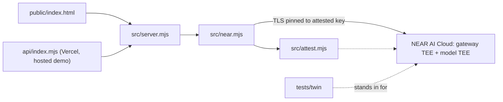

# SafeRedline outline

## Summary (as shipped)

Contract/NDA reviewer, run locally (127.0.0.1) or as a samples-only hosted demo on Vercel (https://saferedline.vercel.app). A Node HTTP handler (runtime dependencies: `ethers`, `@phala/dcap-qvl`) serves a single-file UI. For each analysis it generates a fresh nonce, fetches and verifies NEAR AI Cloud gateway and model attestations (Intel TDX, NVIDIA GPU CC), and only then sends the contract to `z-ai/glm-5.3-flash`. The contract travels only over TLS pinned to the attested gateway key, and the enclave's response signature is verified against the attested key. Nothing is persisted. An offline twin of the NEAR API and a recorded real attestation fixture make `npm test` and `npm run twin` work without network or key.

Honest limits: compose hash not pinned to a release by default; gateway and model see plaintext inside the TEE; our server (local or Vercel) is not attested. See [README.md](README.md) and [docs/threat-model.md](docs/threat-model.md).

## System diagram

## Status

- Shipped 2026-11-11. Hackathon submission saved and verified; X demo post live; hosted demo live at https://saferedline.vercel.app (samples only, rate-limited, Vercel firewall rule). Evidence: [docs/submission-kit.md](docs/submission-kit.md).
- Verified live: 23/23 attestation checks, 29/29 with the signed answer, TLS pinned, non-ASCII signature path confirmed.
- Quality: about 186 offline tests, E2E 30/30 (twin and live), 4 rounds of simulated AI-judge screening; security log in [docs/security-review.md](docs/security-review.md); gitleaks clean.
- Global judging Nov 16-18: keep the repo public, the X post up and the hosted demo running until results.

## Open items

- [ ] Remove em dashes from attestation check-detail strings in `src/attest.mjs` (visible only when a check fails; update test expectations).
- [ ] `HEAD /api/attest` returns 405 while `Allow` lists HEAD; PUT/DELETE return 404 instead of 405 (cosmetic).
- [ ] Rotate the NEAR AI Cloud key after judging (after 2026-11-18); remove or update `NEAR_API_KEY` on Vercel.
- [ ] Stretch: run the hosted server in a TEE (Phala dstack CVM; `/api/server-attestation` and `npm run verify:server` are ready) to close the "server sees plaintext" gap.
- [ ] Stretch: progress indicator during the ~25s analysis; pin compose hashes to published NEAR releases with a refresh command.
- [ ] Stretch: ICM `workspace/` for batch contract review.

## Pointers

| Topic | File |
|---|---|
| Overview, quickstart, judge steps | [README.md](README.md) |
| Entry map for agents | [AGENTS.md](AGENTS.md) |
| Trust chain and data flow | [docs/architecture.md](docs/architecture.md) |
| What is and is not proven | [docs/threat-model.md](docs/threat-model.md) |
| HTTP API contract | [docs/api.md](docs/api.md) |
| 2-minute demo and judge Q&A | [docs/demo-script.md](docs/demo-script.md) |
| Submission fields and drafts | [docs/submission-kit.md](docs/submission-kit.md) |
| Hackathon rules research | [docs/submission-research.md](docs/submission-research.md) |
| Approved plan and defect list | [docs/plans/2026-11-11-architecture-plan.md](docs/plans/2026-11-11-architecture-plan.md) |
| Security review log | [docs/security-review.md](docs/security-review.md) |
| Original spec | [saferedline-vaultnda-spec-v3.md](saferedline-vaultnda-spec-v3.md) |

Link check: `npm run check:docs` (also runs inside `npm test`).
