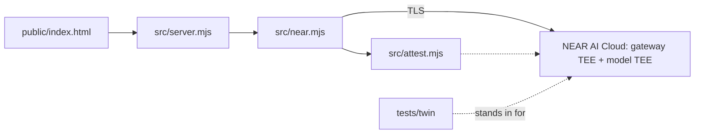

# SafeRedline outline

## Summary (as shipped)

Local contract/NDA reviewer. A Node HTTP server (127.0.0.1, no dependencies beyond `ethers` and `@phala/dcap-qvl`) serves a single-file UI. For each analysis it generates a fresh nonce, fetches and verifies NEAR AI Cloud gateway and model attestations (Intel TDX, NVIDIA GPU CC), and only then sends the contract to `z-ai/glm-5.3-flash`. The enclave's response signature is verified against the attested key. Nothing is persisted. An offline twin of the NEAR API and a recorded real attestation fixture make `npm test` and `npm run twin` work without network or key.

Honest limits: compose hash not pinned to a release by default, gateway/model still see plaintext, our server not attested. See [README.md](README.md) and [docs/threat-model.md](docs/threat-model.md).

## System diagram

## Status

- Docs: README, architecture, threat model, API, demo script, submission kit written; zero-retention line links synced to final code (re-sync if `src/` changes).
- Code and tests: backend, twin and offline tests complete (`npm test`, `npm run twin`); see `next.md` for phase status.
- TLS pinning to the attested gateway key done; 103 tests.
- Confirmed live 2026-11-11: 23/23 counted checks, model-prefixed signed text, algo ecdsa, pinned TLS, signer = attested key.
- Non-ASCII confirmed live: contractor sample `sig_req` passes with `ASCII_SAFE_JSON` on and off.
- Live attestation check list: see README "Cryptographic verification"; informational checks are shown but don't count.
- Code freeze target 16:15 ET, demo 16:30 ET (Nov 11); submission closes Nov 14 23:59 UTC.

## Open items (from next.md "After demo", by Nov 14)

- [ ] User: public GitHub repo, X post (draft in [docs/submission-kit.md](docs/submission-kit.md)), form at nearhackathon.com/#apply.
- [ ] Hosted demo required for judges (Q-012), up until at least Nov 18; stretch: run SafeRedline itself in a TEE (dstack CVM) to close the "server sees plaintext" gap.
- [ ] Stretch: ICM `workspace/` for batch contract review.

## Pointers

| Topic | File |
|---|---|
| Overview, quickstart, judge steps | [README.md](README.md) |
| Entry map for agents | [AGENTS.md](AGENTS.md) |
| Trust chain and data flow | [docs/architecture.md](docs/architecture.md) |
| What is and is not proven | [docs/threat-model.md](docs/threat-model.md) |
| HTTP API contract | [docs/api.md](docs/api.md) |
| 2-minute demo and judge Q&A | [docs/demo-script.md](docs/demo-script.md) |
| Submission fields and drafts | [docs/submission-kit.md](docs/submission-kit.md) |
| Hackathon rules research | [docs/submission-research.md](docs/submission-research.md) |
| Approved plan and defect list | [docs/plans/2026-11-11-architecture-plan.md](docs/plans/2026-11-11-architecture-plan.md) |
| Active task list | [next.md](next.md) |
| Original spec | [saferedline-vaultnda-spec-v3.md](saferedline-vaultnda-spec-v3.md) |

Link check: `npm run check:docs` (also runs inside `npm test`).
