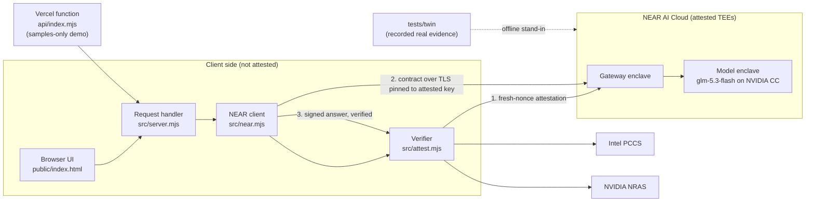

# SafeRedline outline

## Solutions Architect Summary

**What it is.** A contract and NDA reviewer whose AI runs inside NEAR AI Cloud's hardware enclaves (Intel TDX plus NVIDIA confidential GPUs), with every request cryptographically verified by the client before the contract is sent. It ships two ways: a **local server** (the private path for real contracts) and a **samples-only hosted demo** on Vercel. Both run the same request handler.

**Central decisions.**
1. **Verify, don't trust.** The client is the verifier. Before sending, it checks fresh-nonce attestation for the gateway and model enclaves (Intel quote chain, NVIDIA GPU tokens, code hash, runtime log). After the response, it checks the enclave's signature over the exact request and response bytes.
2. **Fail closed.** A missing or failed check means the contract is never sent. Absent evidence counts as failure.
3. **Lock the door to the room.** Contract traffic goes only over TLS pinned to the key bound inside the attested gateway quote.
4. **Stateless by construction.** No database, no write paths, metadata-only logs; a sentinel test enforces it.
5. **Testable without trust or keys.** A digital twin replays recorded real evidence so the whole pipeline and every failure mode run offline.

**Risk boundaries.** Proven: what runs in NEAR's enclaves, freshness, channel binding, response integrity. Not proven: that the enclave code is audited (identified by hash only), that the gateway and model don't see plaintext (they do, inside the TEE), and anything about our own server (local machine or Vercel, neither attested). The hosted demo therefore accepts only bundled fictional samples. Full detail: [docs/threat-model.md](docs/threat-model.md).

## System Diagram

## Status

- Shipped 2026-11-11: hackathon submission saved and verified, X demo post live, hosted demo live at https://saferedline.vercel.app ([docs/submission-kit.md](docs/submission-kit.md)).
- Verified live: every counted attestation and signature check passes over pinned TLS ([README.md](README.md), "Cryptographic verification").
- Quality gates: offline tests, live and twin E2E, docs link guard, and secret scanning all green; review history in [docs/security-review.md](docs/security-review.md).
- Until results (Nov 18): keep the repo public, the X post up and the hosted demo running.

## Open items

- [ ] Remove em dashes from attestation check-detail strings in `src/attest.mjs` (visible only when a check fails).
- [ ] Cosmetic HTTP method handling: `HEAD /api/attest` returns 405 while `Allow` lists HEAD.
- [ ] Rotate the NEAR AI Cloud key after judging (after 2026-11-18) and update it on Vercel.
- [ ] Stretch: run the hosted server in a TEE (Phala dstack) to close the "server sees plaintext" gap; the server-attestation route already exists ([docs/api.md](docs/api.md)).
- [ ] Stretch: progress indicator during analysis; pin compose hashes to published NEAR releases; ICM batch workspace.

## Pointers

| Topic | File |
|---|---|
| Overview, quickstart, judge steps, verification checks | [README.md](README.md) |
| Run/test/verify map and rules for agents | [AGENTS.md](AGENTS.md) |
| Trust chain and data flow | [docs/architecture.md](docs/architecture.md) |
| What is and is not proven | [docs/threat-model.md](docs/threat-model.md) |
| HTTP API contract and error codes | [docs/api.md](docs/api.md) |
| Security review log | [docs/security-review.md](docs/security-review.md) |
| Demo script and judge Q&A | [docs/demo-script.md](docs/demo-script.md) |
| Submission record | [docs/submission-kit.md](docs/submission-kit.md) |
| Hackathon rules research | [docs/submission-research.md](docs/submission-research.md) |
| Original design and defect list (historical) | [docs/plans/2026-11-11-architecture-plan.md](docs/plans/2026-11-11-architecture-plan.md) |
| Original spec (historical) | [saferedline-vaultnda-spec-v3.md](saferedline-vaultnda-spec-v3.md) |
