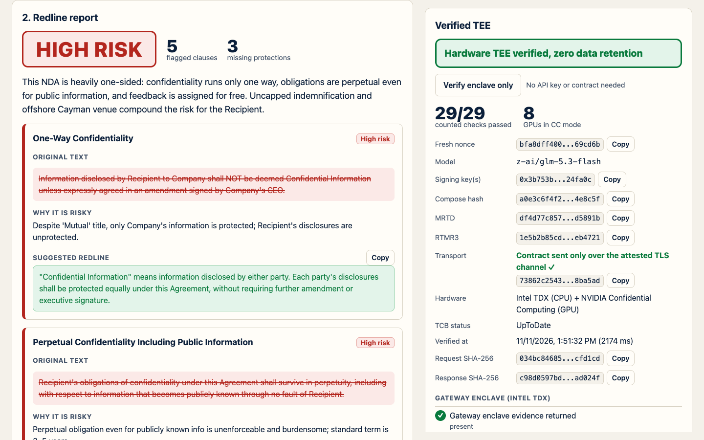
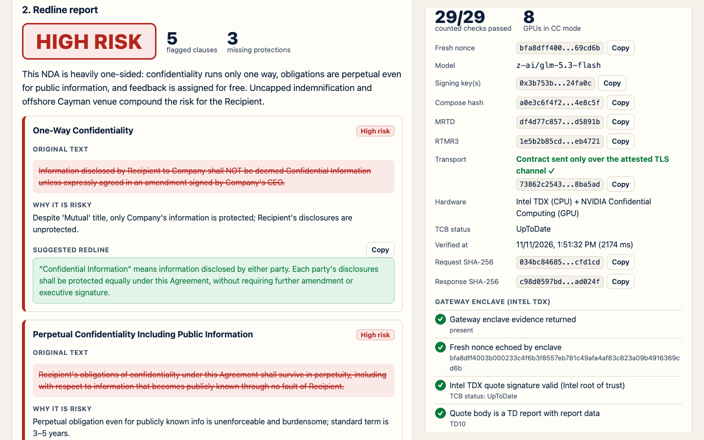
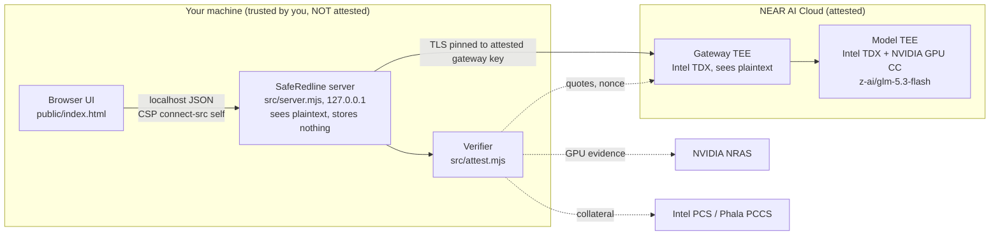

# SafeRedline

Review confidential contracts and NDAs with an LLM that runs inside a NEAR AI Cloud hardware enclave (TEE), and verify that claim cryptographically on every request instead of trusting a privacy policy.

Built by @AlexBuildsNY at the NEAR Private AI Hackathon NYC (Build City x NEAR Legion), Nov 11 2026. Track: Privacy & Private AI. License: MIT.

> **Live demo (fictional samples only): https://saferedline.vercel.app** (deployed 2026-11-11). Honest scope: the hosted demo's own server runs on Vercel and is **not** a TEE, so Vercel can see the sample text; only the bundled fictional samples are accepted (enforced server-side, `403 SAMPLES_ONLY`). The AI call still runs in NEAR's attested enclave with all the verification checks. Review real contracts by running SafeRedline locally (Quickstart below).

> **Live analysis needs your own NEAR AI Cloud key** (free to claim at https://nearbuilders.org/dashboard). Twin mode (`npm run twin`) needs no key: it replays recorded real attestation evidence and scripted model outputs to exercise the verification and failure states; the real model needs a key. The hosted demo is live (see [Hosted demo mode](#hosted-demo-mode)).

**Try it live:** open https://saferedline.vercel.app, click **Verify enclave only** (free, about 2s), load a sample, then click **Analyze privately** (about 25s).

**No key? 3 commands, 60s:** `git clone https://github.com/oocoder/saferedline && cd saferedline && npm ci && npm run twin`




Screenshots show only the bundled fictional sample contract (a real run against NEAR AI Cloud on 2026-11-11).

## The problem

An NDA or term sheet is the document you cannot paste into a normal chatbot: it is confidential, often under NDA itself, and a standard LLM API gives you no proof of where the text went or whether it was kept. People either skip AI review or leak the document. Context: Cyberhaven's 2025 report (vendor telemetry, not peer-reviewed) puts 34.8% of corporate data employees enter into AI tools at "sensitive"; in 2023 Samsung engineers pasted proprietary code into ChatGPT and the company banned internal use. Sources: [docs/judge-qa-research.md](docs/judge-qa-research.md).

## Who it is for

Founders and small legal teams who run SafeRedline **on their own machine** (the server binds to `127.0.0.1`). The only outside party that sees your contract text is NEAR AI Cloud's attested gateway and model enclaves. There is no SafeRedline-operated cloud in the path.

## What it does

1. You load or paste a contract (`.txt`, text `.pdf`, or a bundled fictional sample).
2. The local server fetches a fresh enclave attestation (bound to a new random nonce) and verifies it. If verification fails, **the contract is not sent**.
3. The contract is analyzed by `z-ai/glm-5.3-flash` (a NEAR AI Cloud Confidential TEE model). You get an overall risk rating, flagged clauses (verbatim quote, why it is risky, copy-pasteable redline), and missing standard protections.
4. The enclave's signature over the exact request and response bytes is checked against the attested key. The UI shows every check in a "Verified TEE" panel and turns red if any counted check fails.

## Quickstart

Requires Node >= 20 (`.nvmrc` pins Node 22). Steps are numbered "do X, you should see Y". Notes: `npm ci` also installs `playwright-core` (dev dependency, used only by `npm run e2e`); PDF upload in the browser loads pdf.js from cdnjs, so it needs internet access (paste and `.txt` work offline).

1. `git clone https://github.com/oocoder/saferedline && cd saferedline` -> the repo directory.
2. `npm ci` -> installs 2 direct runtime dependencies (`ethers`, `@phala/dcap-qvl`; 37 packages in the lockfile; `npm audit`: 2 low advisories in `elliptic` via `@phala/dcap-qvl`); no errors.
3. `npm test` -> all tests pass **offline** (recorded real attestation fixture plus a local twin of the NEAR API).
4. `npm run twin` -> prints a localhost URL. Open it: the UI loads with a "TWIN MODE: simulated enclave, not a real TEE" banner. No API key needed. Click a sample, then **Analyze privately**.
5. `npm run verify -- --attest-only` -> **live**, no key needed. Works without a key as of 2026-11-11 (NEAR's agent skill says the attestation endpoints may require a key; if you get an auth error, set `NEAR_API_KEY`). Prints a green check mark per passing check (Intel TDX quote, nonce binding, TLS binding, compose hash, RTMR3 replay, NVIDIA GPU verdict, ...) and ends with a summary line `Verified (attestation only): true`.
6. `cp .env.example .env`, then set `NEAR_API_KEY=sk-...` (claim a key at https://nearbuilders.org/dashboard). `.env` is git-ignored.
7. `npm start` -> prints this when a key is configured (and when it is not, the `API key:` line reads `NOT CONFIGURED (empty, placeholder, or not an sk- key)` and analysis returns `NO_API_KEY`):
   ```
     SafeRedline running → http://127.0.0.1:3000
     Model: z-ai/glm-5.3-flash (NEAR AI Cloud, Confidential TEE)
     API key: configured
     Persistence: none (no disk, no DB, no content logging)
   ```
8. `npm run verify` -> live attestation, one real private completion, and the response-signature checks; the summary line is `Verified: true` (with a key) or `Verified (attestation only): true` (without one). `npm run -s prove > transcript.json` (`-s` keeps npm's banner out of the JSON) writes the same run as a `--json` transcript.

Other commands: `npm run check:docs` (checks that README/docs relative links resolve, that `#L` line anchors point at the code the link text names via a rule table, and that documented `npm` commands exist; `docs/plans/` is excluded as historical; also runs inside `npm test`), `npm run record` (re-records the attestation fixture; **rewrites the tracked** `tests/fixtures/attestation.json`), `npm run prove` (JSON verification transcript), `npm run e2e` (live browser test; needs Chrome and a running server), `npm run demo:record` (records the demo flow).

## Try it as a judge

| Do | You should see |
|---|---|
| `npm run twin`, open the URL | UI with the TWIN banner. Everything below also works here, but the enclave is simulated. |
| Click **Predatory SaaS NDA (High)**, then **Analyze privately** | Overall risk **High**; clause cards for one-sided confidentiality, perpetual term, IP assignment of feedback, uncapped indemnity, Cayman venue (twin: simulated, 5 named clauses; live: the real model's output). |
| Open the right-hand "Verified TEE" panel | A 64-hex nonce, model id, signer address, compose hash, MRTD, TCB status, GPU count, and a grouped list of checks. Every counted check passes; informational checks (ⓘ) such as `measurement_pinning` are shown but don't count. In twin mode the nonce is the one from the RECORDED real attestation, so it does not change. |
| Click **Verify enclave only** | Calls `GET /api/attest`. Live mode (`npm start`, or `npm run verify -- --attest-only`): a fresh nonce is generated on every call. Twin mode: the same recorded nonce each time (it replays recorded evidence). |
| Live mode (`npm start` with a key): repeat the above | Same panel, but the checks ran against NEAR's real Intel TDX + NVIDIA evidence, and the analysis comes from the real model. |
| Click **Balanced Mutual NDA (Low)** | Overall risk **Low**, few or no flagged clauses (baseline comparison). Twin: simulated. |
| Click **Contractor Services Agreement (High)** | Twin (simulated): High. Live: whatever the model returns. |
| Tamper test (twin): `TWIN_SCRIPT=tampered_res npm run twin`, analyze | Panel turns red: **UNVERIFIED RESPONSE**. The signature no longer matches the bytes received. |
| Failure test (twin): `TWIN_SCRIPT=attestation_failed npm run twin`, analyze | Red "Contract NOT sent". The model endpoint receives zero requests. |

Twin scripts, defined in `TWIN_SCRIPTS` in `tests/twin/install.mjs` (lowercase `TWIN_SCRIPT` values, e.g. `ok`, `tampered_res`, `wrong_signer`, `attestation_failed`, `attestation_unavailable`, `nras_down`, `xss`; the file is the full list); see [docs/api.md](docs/api.md) and [docs/demo-script.md](docs/demo-script.md).

## How NEAR is used

- **NEAR AI Cloud, OpenAI-compatible API** at `https://cloud-api.near.ai/v1`: `POST /v1/chat/completions` for the analysis, `GET /v1/models` to list Confidential TEE models (`owned_by == "nearai"`).
- **Model:** `z-ai/glm-5.3-flash`, an open-weight model served in a Confidential TEE (Intel TDX CPU enclave plus NVIDIA GPU confidential computing). Override with `NEAR_MODEL` in `.env`.
- **`GET /v1/attestation/report?model=<model>&provider=near&include_tls_fingerprint=true&signing_algo=ecdsa&nonce=<fresh 64-hex>`**: returns Intel TDX quotes and NVIDIA GPU evidence for the NEAR gateway and the model enclave, bound to our nonce.
- **`GET /v1/signature/{chat_id}?model=...&signing_algo=ecdsa`**: returns the enclave's signature over `model:sha256(request):sha256(response)`.
- NEAR AI Cloud is what puts the model inside the TEE and publishes the keys and evidence needed to check it. Without it this would be an ordinary chatbot with a privacy policy.

Procedure follows https://docs.near.ai/cloud/verification and NEAR's reference verifier (https://github.com/nearai/nearai-cloud-verifier).

## Cryptographic verification

Run per request, in this order, before and after the contract is sent. Any failed check means `verified: false`; missing evidence counts as a failure (fail-closed). See [docs/architecture.md](docs/architecture.md) and the code in [`src/attest.mjs`](src/attest.mjs).

**Before the contract leaves your machine** (for the model enclave, every model instance returned, and the gateway enclave):

| Check | What it proves |
|---|---|
| Fresh nonce generated per request (`crypto.randomBytes(32)`) | Evidence cannot be a replay of an old attestation. |
| `nonce_echo`: enclave echoes our nonce | The report was produced for this request. |
| `tdx_quote`: Intel TDX quote verified with `@phala/dcap-qvl` against Intel collateral | The evidence was signed by genuine Intel TDX hardware; Passes for TCB status `UpToDate`, `SWHardeningNeeded`, `ConfigurationAndSWHardeningNeeded` or `OutOfDate` (same policy as NEAR's reference verifier); the UI shows amber unless `UpToDate`. |
| `td_parse`: quote body parses as a TD report | The checks below really ran (no silent skip). |
| `tdx_debug`: debug bit off | The enclave is a production VM, not a debuggable one whose memory the host could read. |
| `rd_signer`: quote `report_data` binds the enclave signing address | The key that later signs responses lives inside the attested enclave. |
| `rd_nonce`: quote `report_data` binds OUR nonce | The hardware itself vouches for freshness, not just the API JSON. |
| `compose`: `sha256(app_compose)` equals the value in MRCONFIGID | The docker-compose (software manifest) is the one the hardware measured. |
| `rtmr3`: RTMR3 runtime event-log replay matches the quote | The runtime events are the ones extended into the measured register. |
| `compose_event`: the `compose-hash` runtime event equals `sha256(app_compose)` | The measured event log and the manifest agree. |
| `compose_pinned` (only if `EXPECTED_COMPOSE_HASH` is set) | The enclave software matches a hash you chose to trust. |
| `gpu_nonce` and `gpu`: NVIDIA evidence carries our nonce; NVIDIA NRAS tokens (overall and per-GPU) are verified with ES384 against NVIDIA's JWKS, with `eat_nonce` and `exp` checked and at least one GPU, and report confidential-computing mode | The GPU that sees plaintext is a genuine confidential-computing GPU, fresh for this request. |
| `gateway_present`, `model_present` | Both enclaves that see plaintext were actually attested. |
| `tls_bound`: SPKI sha256 of the TLS leaf certificate equals the fingerprint bound in the attested gateway quote; always enforced, in the handshake before any contract byte is written | The endpoint that receives your plaintext is the attested gateway, not a relay in front of it. Mismatch gives `ATTESTATION_FAILED` and the contract is not sent. |
| `measurement_pinning` (informational, not counted in `verified`) | Shows whether a known-good compose hash is pinned via `EXPECTED_COMPOSE_HASH`; off by default. |

**After the response returns:**

| Check | What it proves |
|---|---|
| `sig_req`: signed request hash equals sha256 of the exact bytes we sent | The enclave saw our request, unmodified. |
| `sig_res`: signed response hash equals sha256 of the exact bytes received | The answer was not altered in transit. |
| `sig_algo`: signature is ECDSA | EIP-191 recovery must succeed; fails if a non-ECDSA algorithm is reported. ECDSA is also implied because the signature must EIP-191-recover to an attested address. |
| `sig_ecdsa`: EIP-191 signature recovers to the signing address | The signature is valid. |
| `sig_attested`: recovered address is in the set of keys attested above | The answer came from the attested enclave, not some other key. |
| `sig_model`: signed model id equals the model we asked for | The enclave served the model we requested. |
| `sig_fetch`: signature retrieved from the enclave | A missing signature is a failure, not a pass. |

Confirmed live 2026-11-11 with a real key: `npm run verify` passed all counted checks (23/23); the signed text carries the model prefix (`z-ai/glm-5.3-flash:<req>:<res>`), the reported algorithm is `ecdsa`, the completion and signature went over pinned TLS, and the signer equals the attested model key. Non-ASCII is also confirmed live: the contractor sample's `sig_req` passes with `ASCII_SAFE_JSON` on and off (the gateway hashes the bytes exactly as sent); an offline test covers non-ASCII bytes too.

**Counts (live):** attestation-only (`npm run verify -- --attest-only`, `GET /api/attest`) shows 23 counted checks; a full analysis adds the 6 response-signature checks, so the panel shows 29/29. Informational checks are shown but not counted. Twin mode shows fewer counted checks: `tls_bound` and `sig_attested` are skipped or informational there because the twin uses plain HTTP and a local test key.

The authoritative check list is whatever `GET /api/attest` returns (the model enclave, gateway enclave and GPU each contribute checks; informational ones are shown but don't count); ids are defined in `src/attest.mjs`. Design rationale: the architecture plan ([docs/plans/2026-11-11-architecture-plan.md](docs/plans/2026-11-11-architecture-plan.md)).

## The honest claim

> SafeRedline runs on your machine and sends your contract only to a NEAR AI Cloud model after cryptographically verifying, with a fresh nonce, that the model and gateway run in genuine Intel TDX + NVIDIA confidential-computing enclaves. The contract and signature requests go only over a TLS connection whose certificate key matches the fingerprint bound inside the attested gateway quote, and every answer is checked against an enclave-held key bound to that attestation. SafeRedline itself stores nothing. Limits: the enclave's software is identified by hash, not audited or pinned to a published release, and the attested gateway and model still see your plaintext.

### What is NOT proven

- **The attested gateway still sees plaintext.** TLS pinning proves the endpoint is the attested gateway, not that the gateway or model code is benign; the gateway forwards plaintext to the attested model.
- **Enclave software is identified by hash, not audited.** We show the compose hash but do not pin it to a known-good NEAR release or verify that image digests serve the claimed weights. "No retention inside NEAR" rests on the attested compose being what NEAR publishes.
- **SafeRedline's own server is not attested.** It is not in a TEE and sees plaintext. "Zero retention" on our side is a code-level claim you can verify by reading the code, not a hardware-attested one. OS swap and core dumps are out of scope.
- **Intel TCB status may be `OutOfDate`/`SWHardeningNeeded`.** Our TCB policy matches NEAR's reference verifier, which accepts these, and the status is shown in the UI; they mean a genuine quote on a platform behind Intel's latest advisories.
- **Any proxy in front of NEAR now fails closed.** TLS binding and pinning are always enforced, so a CDN or relay in front of the gateway TEE makes `tls_bound` fail and the contract is not sent.
- **Measurement pinning is optional.** Setting `EXPECTED_COMPOSE_HASH` pins the code hash; otherwise we verify the enclave is genuine and which code hash it runs, not that the hash is a NEAR-published release. Planned fix: ship a pinned list of known-good releases.
- **Responses carry no per-request nonce.** Replay of a response only matters to a party that already holds the plaintext, so we treat it as out of scope; the attestation itself is nonce-bound.
- Model output is untrusted text and can be wrong or hallucinated; `quoteFound` flags clauses whose quote is not verbatim in your contract. This is informational analysis, not legal advice.

Details: [docs/threat-model.md](docs/threat-model.md); separate-agent reviews (self-run, not a third-party audit): [docs/security-review.md](docs/security-review.md).

### Why the compose hash is not pinned by default

NEAR redeploys change the compose hash. A hard-coded pin would fail closed for judges if NEAR updates between Nov 14 and Nov 18. Operators who want a pin set `EXPECTED_COMPOSE_HASH`. Example only, and it goes stale on NEAR redeploys: the model enclave's compose hash was `a0e3c6f4f21a60ea3f5c96bc7ef319b03a184ca2049605399275fbcea74e8c5f` earlier on 2026-11-11 and had already changed (`e8416a02…`) later the same day. The source of truth is `npm run verify -- --attest-only`, which prints the current compose hash.

### Twin mode honesty

In `npm run twin`, responses are signed with a local test key. The response carries a `twinSignerNote` and the test key is shown separately as the twin signer, so it differs from the attested key shown by `/api/attest`; `sig_attested` is informational in twin mode. `tls_bound` is skipped because the twin speaks plain HTTP. The panel labels the evidence "recorded evidence" (`attestation.evidence` is `recorded`). Twin mode demonstrates behavior, not a live enclave.

## Zero data retention

Contract text and model output live only in local variables for the duration of one HTTP request. Links are to the code that enforces or demonstrates it (line numbers synced to the final commit):

- No database, no user-data cache, no session store, no write paths in the server. Evidence: the sentinel test [`tests/pipeline.test.mjs#L254`](tests/pipeline.test.mjs#L254) asserts no writes and no content in logs or errors.
- Request body read into a variable, dropped after use: [`src/server.mjs#L216`](src/server.mjs#L216) and [`#L226`](src/server.mjs#L226)
- Logs are metadata only (method, path, status, ms); never content: [`src/server.mjs#L286-L287`](src/server.mjs#L286-L287)
- `Cache-Control: no-store` and CSP `connect-src 'self'` (the page cannot send the contract anywhere but your localhost server): [`src/server.mjs#L44-L48`](src/server.mjs#L44-L48)
- Server binds `127.0.0.1` by default: default in [`createServer` L157](src/server.mjs#L157), [`HOST` L300](src/server.mjs#L300), [`listen` L305](src/server.mjs#L305)
- Attestation gate: the contract is never sent unless attestation verified (`attestOrThrow`): [`src/near.mjs#L184`](src/near.mjs#L184), called at [`#L206`](src/near.mjs#L206) and [`#L233`](src/near.mjs#L233). Contract text is held only in call-local variables in `analyzeContract` ([`#L203`](src/near.mjs#L203)).
- TLS pinning: [`makePinCheck` `src/attest.mjs#L99`](src/attest.mjs#L99), [`pinnedFetch` `#L113`](src/attest.mjs#L113), [`tls_bound` `#L473`](src/attest.mjs#L473); pin-mismatch handling in [`src/near.mjs#L121`](src/near.mjs#L121)
- NVIDIA JWT verification: [`verifyJwt` `src/attest.mjs#L186`](src/attest.mjs#L186), [`gpuClaimProblems` `#L205`](src/attest.mjs#L205)
- Response-signature verification (after inference): [`verifyResponseSignature` `src/attest.mjs#L516`](src/attest.mjs#L516); [`sig_req` L530](src/attest.mjs#L530), [`sig_model` L532](src/attest.mjs#L532), [`sig_attested` L547](src/attest.mjs#L547)
- Attestation verifier entry points: [`verifyOne` `src/attest.mjs#L293`](src/attest.mjs#L293) (e.g. `rd_signer` [L330](src/attest.mjs#L330)), [`attestModel` `#L431`](src/attest.mjs#L431); the module performs no disk writes or content logging.
- Test that proves it: a sentinel string `ZXQ-SECRET-7731` is analyzed and asserted absent from logs, error bodies and filesystem writes: [`tests/pipeline.test.mjs#L254`](tests/pipeline.test.mjs#L254)
- Local CSRF protection: Host/Origin allowlist (`ALLOWED_HOSTS` adds extra hosts) and JSON-only POST, so another web page cannot make your browser post to your local server: [`src/server.mjs#L236`](src/server.mjs#L236).
- Browser: no `localStorage` of contract text; PDFs are parsed in the browser and only extracted text is sent.

## Configuration

Set in `.env` or the environment (see `.env.example`). Only `NEAR_API_KEY` is required for live mode.

| Variable | Default | Meaning |
|---|---|---|
| `NEAR_API_KEY` | empty in `.env.example` | NEAR AI Cloud key (`sk-...`); a value that is empty, not `sk-...`, or contains `your-key` counts as not configured; not needed for twin or `--attest-only`. A rejected key returns `NEAR_AUTH` ("NEAR AI Cloud rejected the API key (401)") |
| `NEAR_MODEL` | `z-ai/glm-5.3-flash` | Any Confidential TEE model (`owned_by=nearai`) |
| `HOST` | `127.0.0.1` | Bind address; keep local to preserve the privacy story |
| `PORT` | `3000` | Listen port |
| `ALLOWED_HOSTS` | none | Extra Host header values accepted by the local server (CSRF/DNS-rebinding guard) |
| `EXPECTED_COMPOSE_HASH` | unset | If set, the attested compose hash must equal it (`compose_pinned` check) |
| `ASCII_SAFE_JSON` | on | Set `0` to send non-ASCII characters raw in the request JSON instead of `\uXXXX` escapes (the signature hash covers the exact bytes sent) |
| `NEAR_TIMEOUT_MS` | `90000` | Timeout for the inference call; exceeding it returns `INFERENCE_TIMEOUT` |
| `HOSTED_DEMO` | unset | `1` turns on hosted-demo mode (see below) |
| `TRUST_PROXY` | `0` | `1` behind a reverse proxy: client IP = right-most `X-Forwarded-For`; otherwise the header is ignored |
| `DEMO_ANALYZE_LIMIT` / `DEMO_ASK_LIMIT` | `3` / `20` | Analyses / follow-ups per IP per window (hosted demo; per server instance on serverless) |
| `DEMO_WINDOW_MS` | `600000` | Rate-limit window, 10 minutes (hosted demo) |
| `DEMO_DAILY_CAP` | `60` | Analyses plus follow-ups per UTC day, per server instance (hosted demo) |
| `ALLOW_ENDPOINT_OVERRIDE` | unset | Required (`1`) to redirect NEAR/Intel/NVIDIA endpoints via env; the server refuses otherwise, and `/api/health` shows a warning when active. Development only |

A non-loopback `HOST` is refused unless `HOSTED_DEMO=1`, and a public bind with `HOSTED_DEMO=1` also requires `ALLOWED_HOSTS=<public hostname>`.

## Hosted demo mode

Deployed at https://saferedline.vercel.app. `HOSTED_DEMO=1` makes the server a public showcase that only ever processes the bundled fictional samples (anything else returns `403 SAMPLES_ONLY`), with in-memory per-IP and daily rate limits (`429 RATE_LIMITED`) and `mode: 'hosted-demo'` in `/api/health`. Real contracts should still be reviewed locally. Variables: `ALLOWED_HOSTS` (required for a public bind), `TRUST_PROXY`, and the `DEMO_*` limits in the table above.

```
docker build -t saferedline:demo .
docker run --rm -p 3000:3000 -e NEAR_API_KEY=sk-... -e HOSTED_DEMO=1 -e HOST=0.0.0.0 -e ALLOWED_HOSTS=demo.example.org saferedline:demo
# or: NEAR_API_KEY=sk-... ALLOWED_HOSTS=demo.example.org docker compose up -d --build
```

`Dockerfile` and `docker-compose.yml` are in the repo root (pinned base image, read-only filesystem, no secrets baked in).

### Deploying to Vercel

1. `vercel link` (once, in the repo root).
2. Set environment variables for Production: `NEAR_API_KEY` (mark it sensitive), `HOSTED_DEMO=1`, `TRUST_PROXY=1`, `NODEJS_HELPERS=0`, and `ALLOWED_HOSTS=<prod alias>` (your production Vercel hostname).
3. `vercel deploy --prod`, then open the URL, load a sample and check that the Verified TEE panel passes. `GET /api/health` should report `mode: "hosted-demo"`.

Hosted behavior on Vercel: 3 analyses per IP per 10 minutes and a daily cap of 60 per server instance; `GET /api/attest` is cached for 45 seconds in hosted mode; the handler answers with its own JSON error envelope at a 100 second deadline, before the 120 second function limit (`vercel.json`); `/api/health` reports `platform: "vercel"` and `bind: "vercel"`.

Cost protections: the NEAR AI Cloud key's spend cap is the hard backstop. The in-app rate limits (per IP and a daily cap) live in memory, so on serverless they apply per instance and are a best-effort layer, not a global guarantee.

### Planned upgrade: attested hosting

The hosted server is the one party in this setup that is not attested. The planned upgrade is to run the same container in a TEE (Phala dstack CVM) so the server is attested too, and to publish its compose hash for pinning.

## Architecture



More: [docs/architecture.md](docs/architecture.md).

## Libraries and provenance

- Runtime: [`ethers`](https://www.npmjs.com/package/ethers) (EIP-191 signature recovery), [`@phala/dcap-qvl`](https://www.npmjs.com/package/@phala/dcap-qvl) (Intel TDX quote verification). Node built-ins for everything else (`node:http`, `node:crypto`, `node:test`).
- Browser: [pdf.js](https://mozilla.github.io/pdf.js/) 3.11.174 loaded from cdnjs (with SRI) for in-browser PDF text extraction. No other front-end dependencies.
- No pre-hackathon code, templates or boilerplate: built Nov 11 2026; see git history.
- Sample contracts in `samples/` are entirely fictional (company names and terms invented).

## Sample documents (fictional)

- [`samples/sample_predatory_nda.txt`](samples/sample_predatory_nda.txt): one-sided "mutual" NDA with perpetual term, IP assignment of feedback, uncapped indemnity, Cayman venue. Expected risk: High.
- [`samples/sample_balanced_nda.txt`](samples/sample_balanced_nda.txt): standard mutual NDA. Expected risk: Low.
- [`samples/sample_contractor_agreement.txt`](samples/sample_contractor_agreement.txt): contractor agreement; contains non-ASCII characters (smart quotes, section sign) so the live signature check exercises non-ASCII bytes; an offline test also covers non-ASCII request bytes.

## Positioning (not a verified benchmark)

How we frame the product, not a measured comparison. Sources and caveats: [docs/judge-qa-research.md](docs/judge-qa-research.md).

- **Word / Google Docs:** formatting and Track Changes tools; they do not analyze a contract for traps or draft replacement language.
- **Microsoft Copilot / Gemini for Workspace:** privacy rests on contractual commitments; neither offers a customer-verifiable, per-request TEE attestation for these SaaS products.
- **Harvey:** enterprise, sales-led, annual multi-seat contracts. We make no pricing comparison.
- **SMB contract-review tools (Spellbook, LegalOn, GC AI):** compete on contractual zero data retention with LLM providers; none claims TEEs or verifiable attestation. In one line: they promise zero retention; we prove where it ran (within the limits above).

## Roadmap (not built)

Hosted demo; running SafeRedline itself in a TEE (dstack CVM) to close the "our server sees plaintext" gap; Sigstore provenance check of the attested image digests; pinning the compose hash to a known NEAR release; batch review.

## Project layout

See [AGENTS.md](AGENTS.md) (entry map) and [OUTLINE.md](OUTLINE.md) (index).

## Disclaimer

Informational analysis only; not legal advice.

## License

[MIT](LICENSE)
