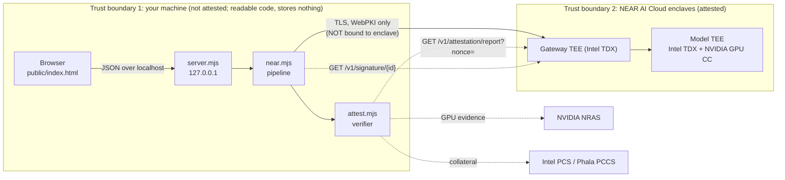

# Architecture

## Trust chain

Browser (localhost) -> **SafeRedline server (our code, not in a TEE, sees plaintext)** -> TLS to `cloud-api.near.ai` -> **NEAR gateway in a TEE (attested, sees plaintext)** -> **model in a TEE with NVIDIA GPU confidential computing (attested, sees plaintext)**.

## Data flow for `POST /api/analyze`

1. Server validates input (50 chars to 512 KB). Bad input: `BAD_INPUT` / `TOO_LARGE`, nothing sent.
2. `attestModel`: new 32-byte nonce; fetch report; verify gateway and every model instance (TDX quote via collateral, debug off, report_data = signer + nonce, compose hash in MRCONFIGID, RTMR3 replay) plus NVIDIA NRAS for GPUs against the same nonce.
3. If not verified: `ATTESTATION_FAILED` (or `ATTESTATION_UNAVAILABLE` if evidence sources are unreachable). **The contract has not been sent.**
4. `POST /v1/chat/completions` with the exact request bytes we hash; response read as raw bytes.
5. `GET /v1/signature/{chat_id}`: verify signed request/response hashes, ECDSA recovery, signer in attested set, signed model id.
6. Respond with analysis, attestation, signature, and top-level `verified = attestation.verified && signature.verified`. A signature failure is a 200 with `verified: false`.
7. Handler returns; nothing was written anywhere.

## Components

| Component | File | Role |
|---|---|---|
| HTTP server | `src/server.mjs` | Static UI, JSON API, security headers, metadata-only logs, binds 127.0.0.1 |
| NEAR client + pipeline | `src/near.mjs` | Prompts, chat call, JSON parsing/normalization, signature retry, error mapping |
| Verifier | `src/attest.mjs` | All attestation and signature checks, injectable `deps` seam for tests |
| Live proof CLI | `scripts/verify_tee.mjs` | Human-readable verification summary |
| Fixture recorder | `scripts/record_fixtures.mjs` | Records real public attestation evidence for offline tests |
| Twin | `tests/twin/near-twin.mjs` | Local fake of NEAR API with scripted failure modes |
| UI | `public/index.html` | Single file, textContent rendering, pdf.js from cdnjs |
| Samples | `samples/*.txt` | Fictional contracts |

## Offline testing model

Real attestation evidence recorded once (`tests/fixtures/attestation.json`) is replayed with its Intel collateral and NRAS responses and a fixed clock, so the real verification code runs offline. The twin signs completions with a test wallet; pairing the real attestation with a twin signature is itself the wrong-signer test.

See also: [threat-model.md](threat-model.md), [api.md](api.md).
